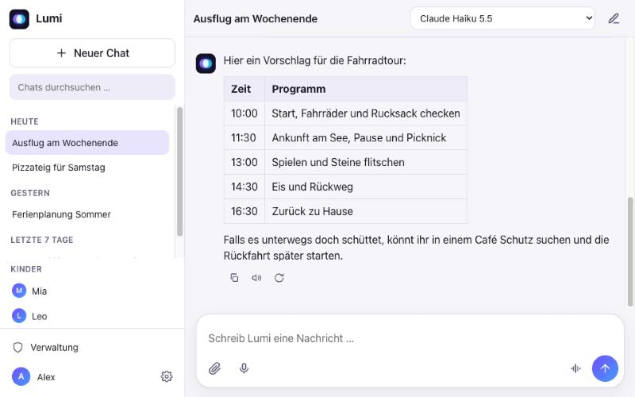
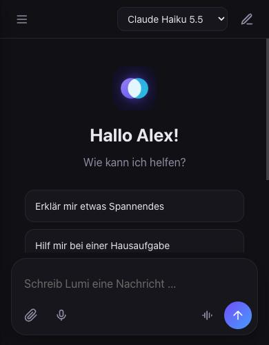
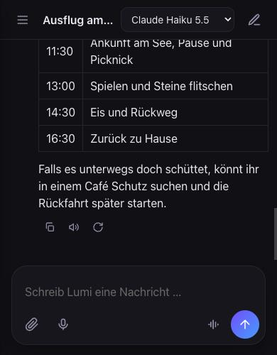
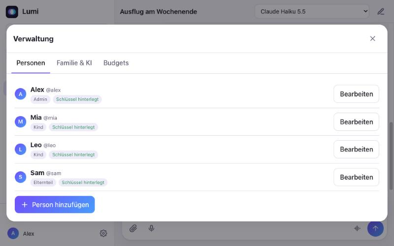

<p align="center"></p>

<h1 align="center">Family AI Server</h1>

<p align="center"><b>Eine private KI für die ganze Familie – läuft auf einem Mac zu Hause.</b><br>
Eine gemeinsame Web-App, ein OpenRouter-Schlüssel pro Person, Eltern-Einsicht für Kinder, Sprachchat und optional Programmierhilfe auf dem eigenen Computer.</p>

<p align="center"><i>English: <a href="README.md">README.md</a></i></p>

Family AI Server ist eine schlanke Familien-KI: Ein Mac im Haus betreibt den Server, alle in der Familie nutzen dieselbe moderne Web-App – auf dem iPhone als App auf dem Home-Bildschirm, am Mac oder Windows-PC im Browser. Die Modelle kommen über [OpenRouter](https://openrouter.ai). Die KI heißt standardmäßig **Lumi** und lässt sich pro Familie umbenennen.

<p align="center"></p>

<p align="center">
  
  
  
</p>

<p align="center"></p>

## Warum dieses Projekt

Etablierte selbst gehostete Chat-Oberflächen wie [Open WebUI](https://github.com/open-webui/open-webui) und [LibreChat](https://github.com/danny-avila/LibreChat) sind mächtig, für eine Familie aber überladen und für Kinder nicht intuitiv genug. Family AI Server macht bewusst weniger: ein klarer Chat, ein Konto pro Person, sichere Voreinstellungen für Kinder und die Einstellungen, die Eltern wirklich brauchen.

## Funktionen

- **Ein Konto pro Person** – Rollen Admin, Elternteil, Kind; Konten legt nur der Admin an.
- **Chat** mit Streaming, Markdown, Code, Verlauf und Suche; Chats per Rechtsklick (am Handy langes Drücken) umbenennen oder löschen.
- **Modelle einfach verwaltet** – ein Standardmodell und ein Eskalationsmodell der Familie, dazu pro Person zusätzliche Modelle. Wer nur das Standardmodell hat, bekommt gar keine Modellauswahl (ideal für Kinder); Admins sehen alle Modelle.
- **Knopf „Stärker antworten“** – beantwortet eine Frage einmal mit einem stärkeren Modell (Familien-Vorgabe, pro Person: Familienstandard, aus oder ein bestimmtes Modell), ohne das Chat-Modell zu ändern.
- **Bilder erzeugen**, **Bilder & Dateien verstehen** (Foto vom Arbeitsblatt, PDF, Word, Text).
- **Sprache**: Diktieren, Vorlesen und Sprachchat (freihändig).
- **Websuche** mit Quellen, **Gedächtnis** pro Person, **Dokumente** durchsuchen.
- **Kosten unter Kontrolle**: ein OpenRouter-Schlüssel pro Person mit Limit; alle sehen ihren Verbrauch als kleinen Ring in der Seitenleiste (nur Prozent, keine Beträge) und der Server mailt bei 80 %/100 % (SMTP mit STARTTLS/TLS und Anmeldung oder lokales Relay).
- **Eltern-Einsicht** pro Kind (Chats und Gedächtnis, nur lesend); ob das Kind einen Hinweis sieht, ist einstellbar.
- **Programmieren auf dem eigenen Computer** (Family AI Runner): die KI liest und schreibt Dateien in *einem* Ordner und führt dort Befehle aus. Jeder Befehl und jedes Schreiben von Dateien wird bestätigt (Popup am Computer, optional im Chat). Läuft als kleine Menüleisten-App (macOS) bzw. Taskleisten-App (Windows); die KI kann auch Bilder aus dem Chat im Ordner speichern.
- **Datenschutz von Anfang an**: nur das Nötige verlässt den Server – nur der Vorname, eine pseudonyme Kennung, „keine Speicherung“ (ZDR) in jeder Anfrage, Websuche über den Modellanbieter. [Was gesendet wird und welche OpenRouter-Einstellungen du als Familien-Admin setzen solltest →](docs/privacy.de.md)
- **Sicher by default**: HTTPS über einen Reverse Proxy, Passkeys, Sperre nach Fehlversuchen, CSRF-Schutz, strenge Content-Security-Policy, Admin-Bereich optional nur aus dem Heimnetz.

## Voraussetzungen

- Ein Mac (macOS 14+) als Server, der durchgehend läuft – oder ein beliebiger Linux-Rechner mit Docker (Server, NAS, Raspberry Pi 5), siehe [Docker](docs/docker.de.md).
- Pro Person ein [OpenRouter](https://openrouter.ai)-Schlüssel (am besten mit Limit und Guardrail).
- Für Zugriff von unterwegs: VPN (empfohlen) oder Reverse Proxy mit HTTPS.

## Installation

> **Schritt-für-Schritt-Anleitung für beide Varianten (Mac und Docker): [docs/installation.de.md](docs/installation.de.md)**

1. App bauen (macOS mit Swift-Toolchain bzw. Command Line Tools und Go): `./Scripts/make-app.sh`, danach `dist/Family AI Server.app` nach `/Programme` ziehen. Fertige Downloads gibt es noch nicht.
2. Beim ersten Öffnen: Rechtsklick → *Öffnen* (die App ist selbstsigniert, nicht von Apple notarisiert). Bei neueren macOS-Versionen ggf. *Systemeinstellungen → Datenschutz & Sicherheit → Trotzdem öffnen*.
3. In der Menüleiste erscheint ein Stern. *Family AI Server öffnen* → erstes Konto anlegen (wird Admin), OpenRouter-Schlüssel eintragen.
4. Unter *Verwaltung* Personen anlegen, Schlüssel, Modelle und Funktionen festlegen.
5. iPhone: Adresse in Safari öffnen → Teilen → *Zum Home-Bildschirm*.

### Docker (Linux, NAS, Server)

Statt der Mac-App gibt es ein Docker-Image für `amd64` und `arm64`: `docker compose up -d` mit der mitgelieferten `docker-compose.yml`. Die OpenRouter-Schlüssel liegen verschlüsselt, der Master-Schlüssel außerhalb des Datenvolumes, und das erste Admin-Konto wird mit einem Einmal-Code aus dem Protokoll angelegt. [Docker-Anleitung →](docs/docker.de.md)

### Erreichbarkeit & HTTPS

Family AI Server lauscht standardmäßig auf Port **8097** (alle Netzwerke, einstellbar). Für Passkeys und die iPhone-App sollte er über **HTTPS** erreichbar sein, z. B. mit [Caddy](https://caddyserver.com):

```
ai.example.org {
    reverse_proxy 127.0.0.1:8097
}
```

Die öffentliche Adresse (`https://ai.example.org`) unter *Verwaltung → Familie & KI* eintragen – sie wird für Passkeys gebraucht. Öffentlich ins Internet stellen ist möglich, VPN bleibt aber die sicherere Wahl.

### OpenRouter-Einstellungen (Datenschutz)

Die App verlangt in jeder Anfrage bereits *Zero Data Retention* und sendet nur den Vornamen. Um das für alle Schlüssel **zu erzwingen**, einmal in OpenRouter einstellen (Details und Begründung: [docs/privacy.de.md](docs/privacy.de.md)):

1. *Settings → Privacy*: Anbieter, die mit Eingaben trainieren dürfen, ausschalten; ZDR für die genutzten Anbietergruppen einschalten.
2. *Default-Workspace → Guardrails*: ZDR für Anthropic, OpenAI, Google, xAI und „Other“ einschalten; Free training aus.
3. Ein Schlüssel pro Person mit Monatslimit.
4. ZDR-fähige Modelle für Embeddings, Bilder, Vorlesen und Diktieren wählen (die Datenschutz-Seite nennt getestete) und jede Funktion einmal testen.

Wenn eure Schlüssel Guardrails mit Modell-Listen haben, müssen dort auch die Modelle für Bilder, Vorlesen, Diktieren und Dokumente (Embeddings) freigegeben sein – sie sind unter *Verwaltung → Familie & KI* einstellbar. Ohne Embedding-Modell funktioniert die Dokumentensuche als Stichwortsuche.

### Sicherung

Die Menüleisten-App sichert den Datenordner täglich um 3 Uhr (14 Stände, Ordner einstellbar). Netzlaufwerke unter `/Volumes` werden nur beschrieben, wenn sie eingehängt sind; sonst wird die Sicherung übersprungen und innerhalb der Stunde erneut versucht.

## Family AI Runner (Programmieren)

1. Der Admin aktiviert für die Person *Programmieren auf eigenem Computer*.
2. Die Person fügt unter *Einstellungen → Computer* ihren Rechner hinzu und erhält einen Schlüssel.
3. Auf derselben Seite die Runner-App laden und starten: Taskleistensymbol unter Windows, Menüleistensymbol unter macOS (Linux: ein einzelnes Terminal-Programm). Kein Terminal nötig: Verbindungsstatus als Symbol, Adresse/Schlüssel/Ordner in einem Fenster, „Beim Anmelden starten“ und „vor dem Schreiben nachfragen“ und „Protokoll anzeigen“ im Menü bzw. in den Einstellungen. Beim ersten Start fragt sie nach Serveradresse, Schlüssel und Arbeitsordner und merkt sie sich. macOS: ZIP entpacken, nach „Programme“ ziehen, starten; bei der Sperre („nicht geöffnet“) einmal Systemeinstellungen → Datenschutz & Sicherheit → „Trotzdem öffnen“ (die App ist nicht von Apple beglaubigt).
   - Windows zeigt beim ersten Start eine SmartScreen-Warnung (unbekannter Herausgeber): *Weitere Informationen → Trotzdem ausführen*. (Die Windows-App wurde noch nicht auf einem echten PC ausgeführt.)
4. In einem Chat oben auf das Symbol `</>` klicken, um auf dem Computer zu programmieren (bei mehreren Computern wählt man einen aus). Ein Klick auf das Symbol beendet es wieder. In der Chatliste zeigt `</>` mit grünem Punkt, dass der Runner verbunden ist.

Der Runner baut nur ausgehende Verbindungen auf und öffnet keinen Port. Beim Beenden (Strg+C, Fenster schließen) meldet er sich ab; nach einem Neustart des Servers verbindet er sich innerhalb weniger Sekunden selbst wieder. Die KI darf Dateien im Arbeitsordner auflisten und lesen; außerhalb ist über die Datei-Werkzeuge nichts erreichbar. **Jeder Befehl und jedes Schreiben von Dateien** (auch das Speichern eines Bildes aus dem Chat im Ordner) muss am Computer per Dialog bestätigt werden. Optional (nur in der Runner-App auf dem Computer einstellbar, nie vom Server): „Freigabe im Chat statt als Popup“ – dann erscheinen Erlauben/Ablehnen im Chat. Optionen: `--allow-writes` (Dateien ohne Nachfrage schreiben), `--setup` (neu einrichten), `--allow-all` (nichts fragen – nicht empfohlen).

Befehle können technisch den ganzen Computer erreichen – deshalb wird jeder einzeln bestätigt. Für Kinder empfiehlt sich ein eigenes Windows-Konto.

## Entwicklung

```
swift build
swift run FamilyAIChecks                      # Selbstprüfungen
swift run FamilyAIServer --serve --port 8197 --data /tmp/family-ai --keys-file /tmp/family-ai-keys.json
(cd Runner && go test ./...)              # Runner-Tests (Go)
CODESIGN_IDENTITY="Mein Zertifikat" ./Scripts/make-app.sh   # baut dist/Family AI Server.app inkl. Runner-Downloads
```

Aufbau: `Sources/FamilyAICore` (Server: Hummingbird, SQLite, OpenRouter-Client, Chat-Engine mit Werkzeugen), `Sources/FamilyAIServer` (Menüleisten-App), `Web/` (Web-App ohne Build-Schritt, reines JavaScript), `Runner/` (Family AI Runner in Go).

## Lizenz

MIT – siehe [LICENSE](LICENSE). Abhängigkeiten: Hummingbird, swift-http-types (Apache-2.0), webauthn-swift (Apache-2.0), swift-cbor (MIT). Der Runner nutzt nur die Go-Standardbibliothek (BSD-3-Clause).
