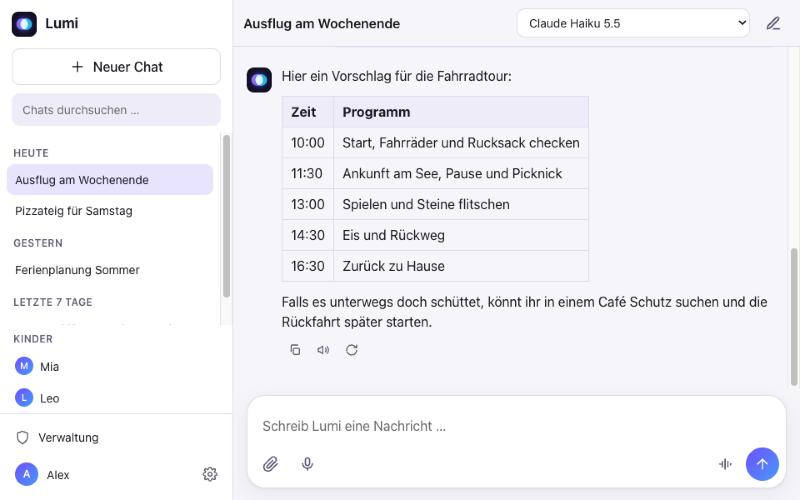
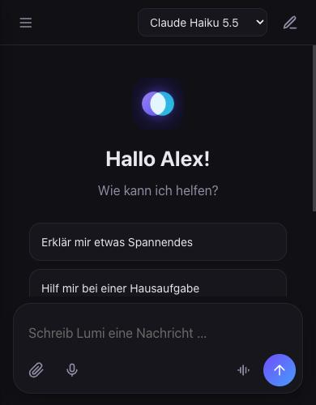
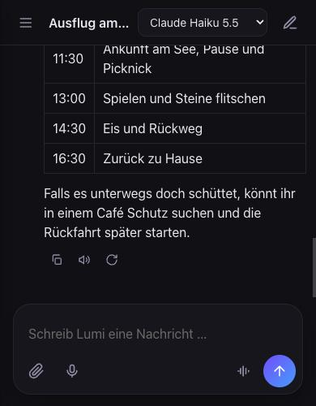
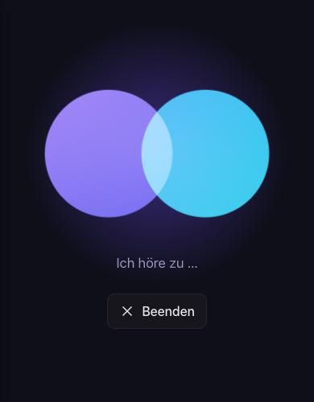
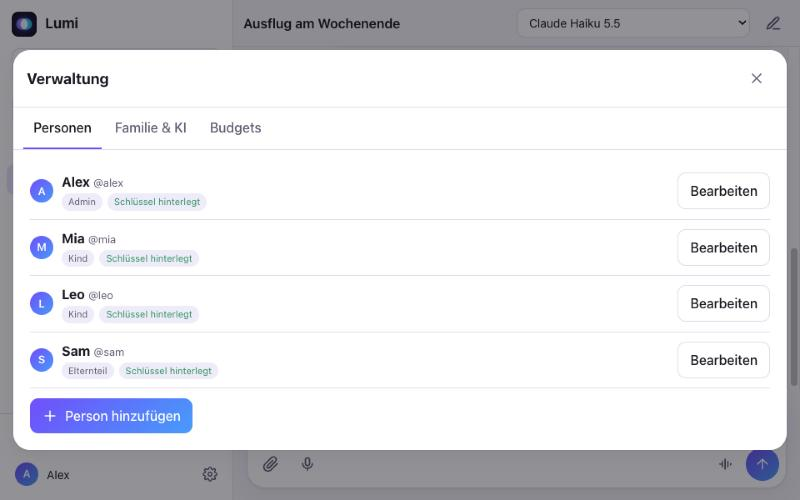

<p align="center"></p>

<h1 align="center">Family AI Server</h1>

<p align="center"><b>A private AI assistant for the whole family – running on a Mac at home.</b><br>
One shared web app, one OpenRouter key per person, parental view for children, voice chat, and optional coding help on your own computer.</p>

<p align="center"><i>Deutsch: <a href="README.de.md">README.de.md</a></i></p>

A simple, private AI for the whole family: one Mac runs the server, everyone uses the same modern web app – on the iPhone as an app on the home screen, on a Mac or Windows PC in the browser. Models come from [OpenRouter](https://openrouter.ai). The AI is called **Lumi** by default and can be renamed per family.

> Status: early version (0.1). Used daily by one family. Passkeys work; the Windows runner is cross-compiled and unit-tested but has not been verified on a real Windows PC yet.

<p align="center"></p>

<p align="center">
  
  
  
</p>

<p align="center"></p>

## Why this project

Established self-hosted chat front ends such as [Open WebUI](https://github.com/open-webui/open-webui) and [LibreChat](https://github.com/danny-avila/LibreChat) are powerful, but for a family they are overloaded and not intuitive enough for children. Family AI Server does less on purpose: one clear chat, one account per person, safe defaults for kids, and the controls parents actually need.

## Features

- **One account per person** – roles admin, parent, child; only the admin creates accounts.
- **Chat** with streaming, Markdown, code, history and search; rename or delete chats via right-click (long-press on touch).
- **Models, simply managed** – a family default model and a family escalation model, plus extra models per person on top. People with only the default model get no model picker at all (ideal for children); admins see every model.
- **“Stronger answer” button** – re-answers one question with a stronger model (family-wide setting, per person: family default, off, or a specific model) without changing the chat model.
- **Create images**, **understand images & files** (photo of a worksheet, PDF, Word, text).
- **Voice**: dictation, read-aloud and hands-free voice chat.
- **Web search** with sources, **memory** per person, **search your documents**.
- **Costs under control**: one OpenRouter key per person with a limit; the server shows usage and mails at 80 % / 100 % (SMTP with STARTTLS/TLS and login, or a local relay).
- **Parental view** per child (chats and memory, read-only); whether the child sees a notice is configurable.
- **Coding on your own computer** (Family AI Runner): the AI reads and writes files in *one* folder and runs commands there – every command is confirmed on the computer.
- **Privacy by design**: only what an answer needs leaves the server – first name only, a pseudonymous ID, “no retention” (ZDR) requested in every request, web search through the model provider. [What is sent, and the OpenRouter settings to make as family admin →](docs/privacy.md)
- **Secure by default**: HTTPS via a reverse proxy, passkeys, lockout after failed logins, CSRF protection, strict Content Security Policy, admin area optionally restricted to the home network.

## Requirements

- A Mac (macOS 14+) as server that runs all the time – or any Linux host with Docker (server, NAS, Raspberry Pi 5), see [Docker](docs/docker.md).
- One [OpenRouter](https://openrouter.ai) key per person (ideally with a limit and guardrail).
- For access from outside: VPN (recommended) or a reverse proxy with HTTPS.

## Installation

> **Step-by-step guide for both variants (Mac and Docker): [docs/installation.md](docs/installation.md)**

1. Build the app (needs macOS with the Swift toolchain / Command Line Tools and Go): `./Scripts/make-app.sh`, then move `dist/Family AI Server.app` to `/Applications`. Pre-built downloads are not offered yet.
2. On first launch: right-click → *Open* (the app is self-signed, not notarized by Apple). On newer macOS versions: *System Settings → Privacy & Security → Open Anyway*.
3. A star appears in the menu bar. *Open Family AI Server* → create the first account (becomes admin), enter your OpenRouter key.
4. Under *Admin*, create people and set keys, models and features.
5. iPhone: open the address in Safari → Share → *Add to Home Screen*.

### Docker (Linux, NAS, server)

Instead of the Mac app there is a Docker image for `amd64` and `arm64`: `docker compose up -d` with the supplied `docker-compose.yml`. The OpenRouter keys are stored encrypted with a master key kept outside the data volume, and the first admin is created with a one-time code from the log. [Docker guide →](docs/docker.md)

### Reachability & HTTPS

Family AI Server listens on port **8097** (all networks, configurable). For passkeys and the iPhone app, it should be reachable via **HTTPS**, e.g. with [Caddy](https://caddyserver.com):

```
ai.example.org {
    reverse_proxy 127.0.0.1:8097
}
```

Enter the public address (`https://ai.example.org`) under *Admin → Family & AI* – passkeys need it. Exposing it to the internet is possible, but a VPN remains the safer choice.

### OpenRouter settings (privacy)

The app already requests *Zero Data Retention* in every request and sends only the first name. To **enforce** it for all keys, set this once in OpenRouter (details and reasons: [docs/privacy.md](docs/privacy.md)):

1. *Settings → Privacy*: disable providers that may train on inputs; enable ZDR for the provider groups you use.
2. *Default workspace → Guardrails*: enable ZDR for Anthropic, OpenAI, Google, xAI and "Other"; free training off.
3. One key per person with a monthly limit.
4. Pick ZDR-capable models for embeddings, images, read-aloud and dictation (the privacy page lists tested ones) and test each function once.

If your keys use guardrails with model lists, also allow the models for images, read-aloud, dictation and documents (embeddings) – they are configurable under *Admin → Family & AI*. Without an embedding model, document search falls back to keyword search.

### Backups

The menu bar app backs up the data folder daily at 3 a.m. (14 copies kept, folder configurable). Network drives under `/Volumes` are only written to while they are mounted; otherwise the backup is skipped and retried within the hour.

## Family AI Runner (coding)

1. The admin enables *Coding on own computer* for the person.
2. The person adds their computer under *Settings → Computers* and gets a key.
3. Download the runner from the same page (Windows, macOS, Linux – a single program, nothing else to install) and start it with a double-click. On first start it asks for the server address, the key and the workspace folder and remembers them.
   - Windows shows a SmartScreen warning the first time (unknown publisher): *More info → Run anyway*.
   - macOS: `xattr -d com.apple.quarantine family-ai-runner-macos; chmod +x family-ai-runner-macos`, then `./family-ai-runner-macos`.
4. *New chat → Coding on …*

The runner only makes outgoing connections and opens no port. The AI may list, read and write files inside the workspace folder; nothing outside it is reachable through the file tools. **Every command** has to be confirmed in a dialog on the computer. Options: `--confirm-writes` (also ask before writing files), `--setup` (set up again), `--allow-all` (ask for nothing – not recommended).

Commands can technically reach the whole computer – that is why each one is confirmed. For children, a separate Windows account is a good idea.

## Development

```
swift build
swift run FamilyAIChecks                      # self-checks
swift run FamilyAIServer --serve --port 8197 --data /tmp/family-ai --keys-file /tmp/family-ai-keys.json
(cd Runner && go test ./...)              # runner tests (Go)
CODESIGN_IDENTITY="My certificate" ./Scripts/make-app.sh   # builds dist/Family AI Server.app incl. runner downloads
```

Layout: `Sources/FamilyAICore` (server: Hummingbird, SQLite, OpenRouter client, chat engine with tools), `Sources/FamilyAIServer` (menu bar app), `Web/` (web app without a build step, plain JavaScript), `Runner/` (Family AI Runner in Go).

## License

MIT – see [LICENSE](LICENSE). Dependencies: Hummingbird, swift-http-types (Apache-2.0), webauthn-swift (Apache-2.0), swift-cbor (MIT). The runner uses only the Go standard library (BSD-3-Clause).
